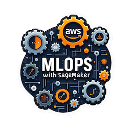
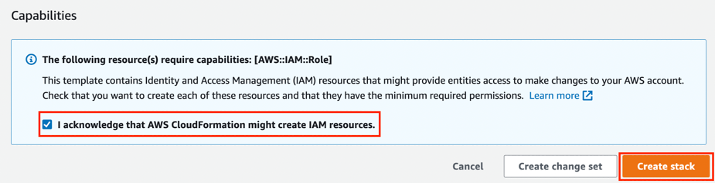
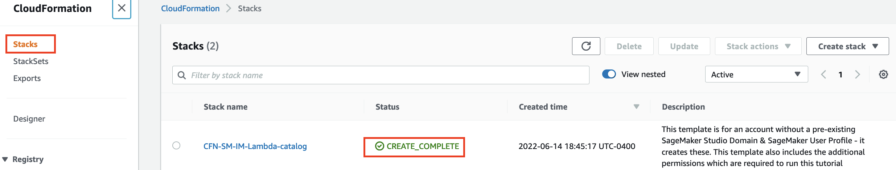
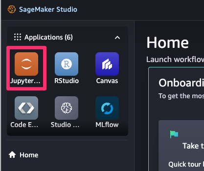
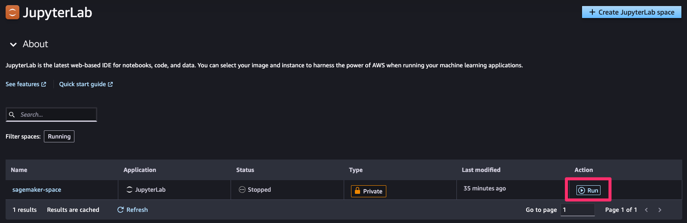
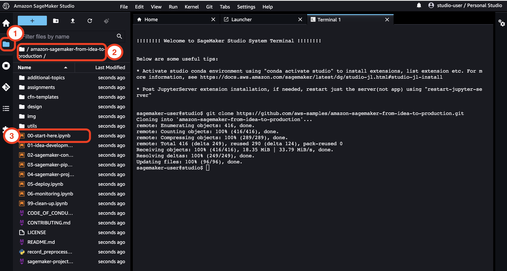
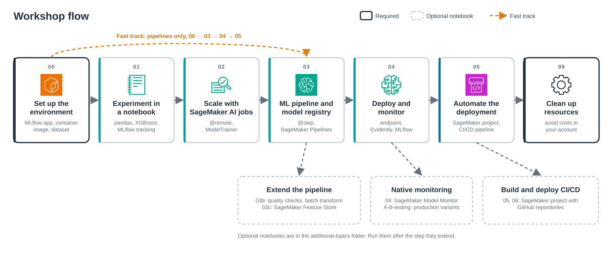

# Amazon SageMaker AI MLOps: from idea to production in five steps



This repository contains a sequence of Jupyter notebooks demonstrating how to move from an ML idea to production by using [Amazon SageMaker AI](https://aws.amazon.com/sagemaker-ai).

The notebooks use SageMaker AI [processing](https://docs.aws.amazon.com/sagemaker/latest/dg/processing-job.html) and [training](https://docs.aws.amazon.com/sagemaker/latest/dg/train-model.html) jobs with the [`@remote` decorator](https://docs.aws.amazon.com/sagemaker/latest/dg/train-remote-decorator.html) and `ModelTrainer`, and SageMaker AI MLOps features such as [SageMaker Pipelines](https://aws.amazon.com/sagemaker/pipelines/), [SageMaker Model Registry](https://docs.aws.amazon.com/sagemaker/latest/dg/model-registry.html), [SageMaker managed MLflow](https://docs.aws.amazon.com/sagemaker/latest/dg/mlflow.html), and [SageMaker projects](https://docs.aws.amazon.com/sagemaker/latest/dg/sagemaker-projects.html). Optional notebooks show A/B testing with production variants and a SageMaker project with GitHub repositories.

You start with a notebook with basic ML code for data preprocessing, feature engineering, and model training, all in the notebook. Each next notebook builds on the previous one and adds one or more SageMaker AI MLOps features.

Each notebook also provides links to useful hands-on resources and proposes real-world ideas for additional development.

You develop your ML idea from an experimental notebook to a production-ready solution that follows the recommended MLOps practices. Notebook [00-start-here](00-start-here.ipynb) sets up the environment for all steps:

|Step|What|Notebook|
|---|---|---|
|1. |Experiment in a notebook |[01-idea-development](01-idea-development.ipynb)|
|2. |Scale with SageMaker AI jobs and Python SDK |[02-sagemaker-containers](02-sagemaker-containers.ipynb)|
|3. |Operationalize with ML pipeline, model registry |[03-sagemaker-pipeline](03-sagemaker-pipeline.ipynb)|
|4. |Deploy the model and add data and model monitoring |[04-deployment-and-monitoring](04-deployment-and-monitoring.ipynb)|
|5. |Automate model deployment with a SageMaker project |[05-templatize-deployment](05-templatize-deployment.ipynb)|

## Additional topics
The `additional-topics` folder has optional notebooks that extend the main steps:

|Notebook|What|
|---|---|
|[A-B-testing](additional-topics/A-B-testing.ipynb)|Test model variants on one endpoint with [production variants](https://docs.aws.amazon.com/sagemaker/latest/dg/model-validation.html)|
|[05-sagemaker-project](additional-topics/05-sagemaker-project.ipynb) and [06-deploy](additional-topics/06-deploy.ipynb)|A SageMaker project with CI/CD pipelines for model building and model deployment, connected to your own GitHub repositories|

## Getting started
For the full version of the instructions and detailed setup of the account refer to the public AWS workshop [Amazon SageMaker MLOps: from idea to production in six steps](https://catalog.workshops.aws/mlops-from-idea-to-production).

### Prerequisites
You need an **AWS account**. If you don't already have an account, follow the [Setting Up Your AWS Environment](https://aws.amazon.com/getting-started/guides/setup-environment/) getting started guide for a quick overview.

### AWS Instructor-led workshop
If you participate in an AWS Immersion Day or a similar instructor-led event and use a provided AWS account, follow these [instructions](https://catalog.workshops.aws/mlops-from-idea-to-production/en-US/00-introduction/20-getting-started-workshop-studio) to claim your temporary AWS account and to start SageMaker AI Studio.

❗ Skip the following steps **Set up Amazon SageMaker AI domain** and **Deploy CloudFormation template** if you use an AWS-provisioned account.

### Set up Amazon SageMaker AI domain
To run the notebooks you must use [SageMaker AI Studio](https://aws.amazon.com/sagemaker/studio/) which requires a [SageMaker AI domain](https://docs.aws.amazon.com/sagemaker/latest/dg/studio-entity-status.html).

#### Existing SageMaker AI domain
If you already have a SageMaker AI domain and would like to use it to run the workshop, follow the [SageMaker AI Studio setup guide](https://aws.amazon.com/getting-started/hands-on/machine-learning-tutorial-set-up-sagemaker-studio-account-permissions/) to attach the required AWS IAM policies to the IAM execution role used by your Studio user profile. For this workshop you must attach the following managed IAM policies to the IAM execution role of the user profile you use to run the workshop:
- `AmazonSageMakerFullAccess`
- `AWSCloudFormationFullAccess`
- `AWSCodePipeline_FullAccess`
- `AmazonSageMakerPipelinesIntegrations`
- `AWSCodeStarFullAccess`

You can also [create a new user profile](https://docs.aws.amazon.com/sagemaker/latest/dg/domain-user-profile-add-remove.html) with a dedicated IAM execution role to use for this workshop.

#### Provision a new SageMaker AI domain
If you don't have a SageMaker AI domain or would like to use a dedicated domain for the workshop, you must create a new domain.

❗ If you have more than one domain in your account, consider the limit of the active domains in a Region in an account.

To create a new domain, you can follow the onboarding [instructions](https://docs.aws.amazon.com/sagemaker/latest/dg/onboard-quick-start.html) in the Developer Guide or use the provided AWS CloudFormation [template](https://github.com/aws-samples/amazon-sagemaker-from-idea-to-production/blob/master/cfn-templates/sagemaker-domain.yaml) that creates a SageMaker AI domain, a user profile, and adds the IAM roles required for executing the provided notebooks.

❗ If you create a new domain via AWS Console, make sure you attach the following policies to the IAM execution role of the user profile:
- `AmazonSageMakerFullAccess`
- `AWSCloudFormationFullAccess`
- `AWSCodePipeline_FullAccess`
- `AmazonSageMakerPipelinesIntegrations`
- `AWSCodeStarFullAccess`

❗ If you use the provided CloudFormation template for domain creation, the template creates an IAM execution role with the following policies attached:
- `AmazonSageMakerFullAccess`
- `AmazonS3FullAccess`
- `AWSCloudFormationFullAccess`
- `AWSCodePipeline_FullAccess`
- `AmazonSageMakerPipelinesIntegrations`
- `AWSCodeStarFullAccess`

Download the [`sagemaker-domain.yaml` CloudFormation template](https://github.com/aws-samples/amazon-sagemaker-from-idea-to-production/blob/master/cfn-templates/sagemaker-domain.yaml).

This template creates a new SageMaker AI domain and a user profile named `studio-user-<UUID>`. It also creates the required IAM execution role for the domain. 

❗ This stack assumes that you already have a public VPC set up in your account. If you do not have a public VPC, see [VPC with a single public subnet](https://docs.aws.amazon.com/vpc/latest/userguide/VPC_Scenario1.html) to learn how to create a public VPC. 

❗ The template supports only `us-east-1`, `us-west-2`, and `eu-central-1` Regions. Select one of those regions for deployment.

Open [AWS CloudFormation console](https://us-east-1.console.aws.amazon.com/cloudformation/home?region=us-east-1#/stacks/create). The link opens the AWS CloudFormation console in your AWS account. Check the selected region and change it if needed. 
- Select **Upload a template file** and upload the downloaded CloudFormation template, click **Next** 
- Enter the stack name, for example `sagemaker-from-idea-to-prod`, click **Next**
- Leave all defaults on this pane, click **Next**
- Select **I acknowledge that AWS CloudFormation might create IAM resources**, click **Submit**



On the **CloudFormation** pane, choose **Stacks**. It takes about 15 minutes for the stack to be created. When the stack is created, the status of the stack changes from `CREATE_IN_PROGRESS` to `CREATE_COMPLETE`. 



### Start SageMaker AI Studio
After signing into the AWS account, follow [Launch Amazon SageMaker AI Studio](https://docs.aws.amazon.com/sagemaker/latest/dg/studio-updated-launch.html#studio-updated-launch-console) instructions to open Studio.

### Open JupyterLab space
You use a JupyterLab space as our IDE for this workshop. 
After launching the Studio:

1. To launch a JupyterLab space, select the `JupyterLab` app in the top left

   
   
2. Each application in SageMaker AI studio gets its own space. Spaces are used to manage the storage and resource needs of each application. If you're participating in an AWS-led workshop or used the provided CloudFormation template, the required space is already created for you, otherwise you must create a new JupyterLab space as described in the [Developer Guide](https://docs.aws.amazon.com/sagemaker/latest/dg/studio-updated-jl-user-guide.html) or re-use an existing one

3. Run the space by selecting the run button on the right. This process can take a few seconds.

   

4. Once the space is running select `Open` to navigate to the JupyterLab application. 

### Start the workshop
If you're participating in an AWS-led workshop or used the provided CloudFormation template, the workshop content is cloned on the space EBS volume automatically, no action required from you. If you use your own domain and user profile or created a domain via AWS Console UI, follow the instructions in the next section **Download notebooks into your JupyterLab space** to clone the content.

The public GitHub repository [Amazon SageMaker MLOps: from idea to production in six steps](https://github.com/aws-samples/amazon-sagemaker-from-idea-to-production) contains all source code.

#### Download notebooks into your JupyterLab space
You only need to clone the notebooks into your space if you use your own domain and user profile. To do this select `Terminal` in the JupyterLab Launcher window or select **File** > **New** > **Terminal** to open up a terminal and run the `git clone`:

```sh
git clone https://github.com/aws-samples/amazon-sagemaker-from-idea-to-production.git
```

This will clone the repository into the local JupyterLab file system.

#### Open and execute a setup notebook
As the final preparatory step, make sure to run and execute the `00-start-here.ipynb` notebook. To do this

1. In the file browser open the `amazon-sagemaker-from-idea-to-production` folder by double clicking it
2. Open `00-start-here.ipynb` notebook and follow the instructions in the notebook



Note: we recommend you read and then execute each cell by using the `Shift + Enter`command.

After executing the `00-start-here.ipynb` notebook, you can move to the first notebook [`01-idea-development`](01-idea-development.ipynb).

## How to use this workshop
Go through the notebooks, run the code cells in order, and follow the instructions. The following diagram shows the flow of the workshop:



Go through the notebooks `00-...`, `01-...`, ..., `05-...` and run all code cells with `Shift` + `Enter`. The instructions explain what the code does and why. You need about two and a half hours for all notebooks.
All notebooks are idempotent. Run the code cells in order, from top to bottom.

## Clean-up
❗ You don't need to perform a clean-up if you run an AWS-instructor led workshop.

To avoid charges, you must remove all project-provisioned and generated resources from your AWS account. 

First, run all steps in the provided [clean-up notebook](99-clean-up.ipynb).
Second, if you used the AWS Console to provision a domain for this workshop, and don't need the domain, you can delete the domain by following [these instructions](https://docs.aws.amazon.com/sagemaker/latest/dg/gs-studio-delete-domain.html). 

If you provisioned the domain with the CloudFormation template, you can delete the CloudFormation stack in the AWS console.

If you provisioned a new VPC for the domain, go to the [VPC console](https://console.aws.amazon.com/vpc/home?#vpcs) and delete the provisioned VPC.

## Dataset
This example uses the [direct marketing dataset](https://archive.ics.uci.edu/ml/datasets/bank+marketing) from UCI's ML Repository:
> [Moro et al., 2014] S. Moro, P. Cortez and P. Rita. A Data-Driven Approach to Predict the Success of Bank Telemarketing. Decision Support Systems, Elsevier, 62:22-31, June 2014

## Resources
Hands-on resources to get started with ML development on Amazon SageMaker AI:

- [Get started with Amazon SageMaker](https://aws.amazon.com/sagemaker/getting-started/)
- [Deep Learning MLOps workshop with Amazon SageMaker](https://catalog.us-east-1.prod.workshops.aws/workshops/47906c57-854e-4c73-abdb-6b49fe364370/en-US)
- [Scale complete ML development with Amazon SageMaker Studio](https://catalog.us-east-1.prod.workshops.aws/workshops/ffc82198-8918-44c3-8b06-2c934f73fe50/en-US)
- [Amazon SageMaker 101 workshop](https://catalog.us-east-1.prod.workshops.aws/workshops/0c6b8a23-b837-4e0f-b2e2-4a3ffd7d645b/en-US)
- [Amazon SageMaker 101 workshop code repository](https://github.com/aws-samples/sagemaker-101-workshop)
- [Amazon SageMaker Immersion Day](https://catalog.us-east-1.prod.workshops.aws/workshops/63069e26-921c-4ce1-9cc7-dd882ff62575/en-US)
- [End to end Machine Learning with Amazon SageMaker](https://github.com/aws-samples/amazon-sagemaker-build-train-deploy)
- [SageMaker MLOps Workshop](https://catalog.us-east-1.prod.workshops.aws/workshops/1bb7ba03-e533-464f-8726-91a74513b1a1/en-US)
- [Amazon SageMaker MLOps Workshop](https://catalog.us-east-1.prod.workshops.aws/workshops/7acdc7d8-0ac0-44de-bd9b-e3407147a59c/en-US)
- [A curated list of awesome references for Amazon SageMaker](https://github.com/aws-samples/awesome-sagemaker)
- [AWS Multi-Account Data & ML Governance Workshop](https://catalog.us-east-1.prod.workshops.aws/workshops/367f5c92-0764-4959-9279-e6f105f0c670/en-US)

---

## QR code for this repository
Use the following QR code to link this repository.


[https://bit.ly/3KkhzYW](https://bit.ly/3KkhzYW)

## QR code for the workshop
Use the following QR code to link the public AWS [workshop](https://catalog.workshops.aws/mlops-from-idea-to-production/en-US).


[https://bit.ly/3zjk07S](https://bit.ly/3zjk07S)

---

Copyright Amazon.com, Inc. or its affiliates. All Rights Reserved.
SPDX-License-Identifier: MIT-0
